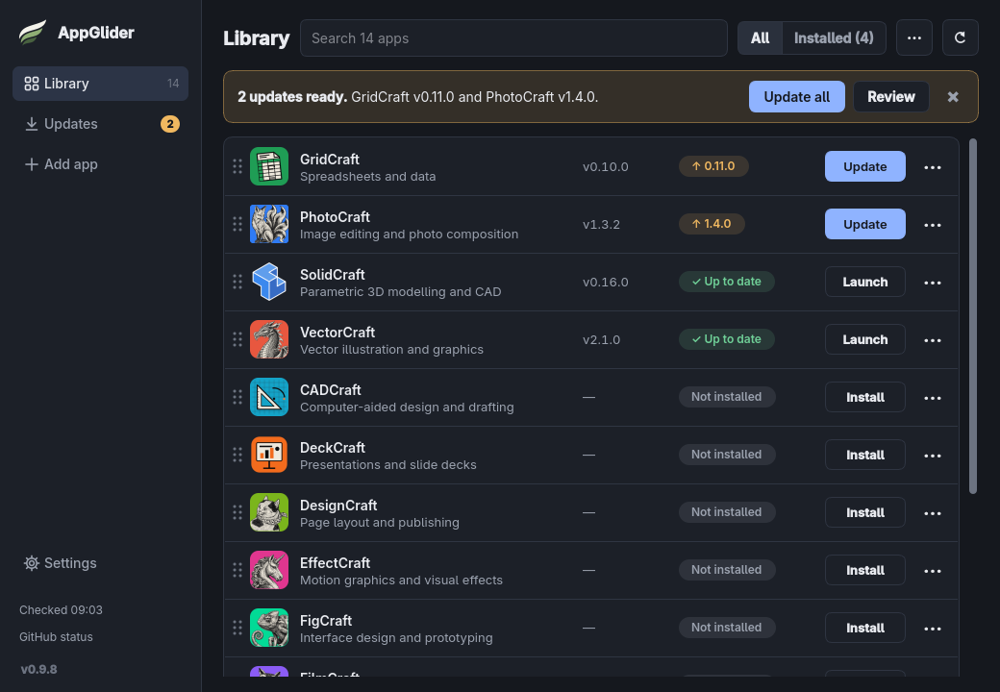
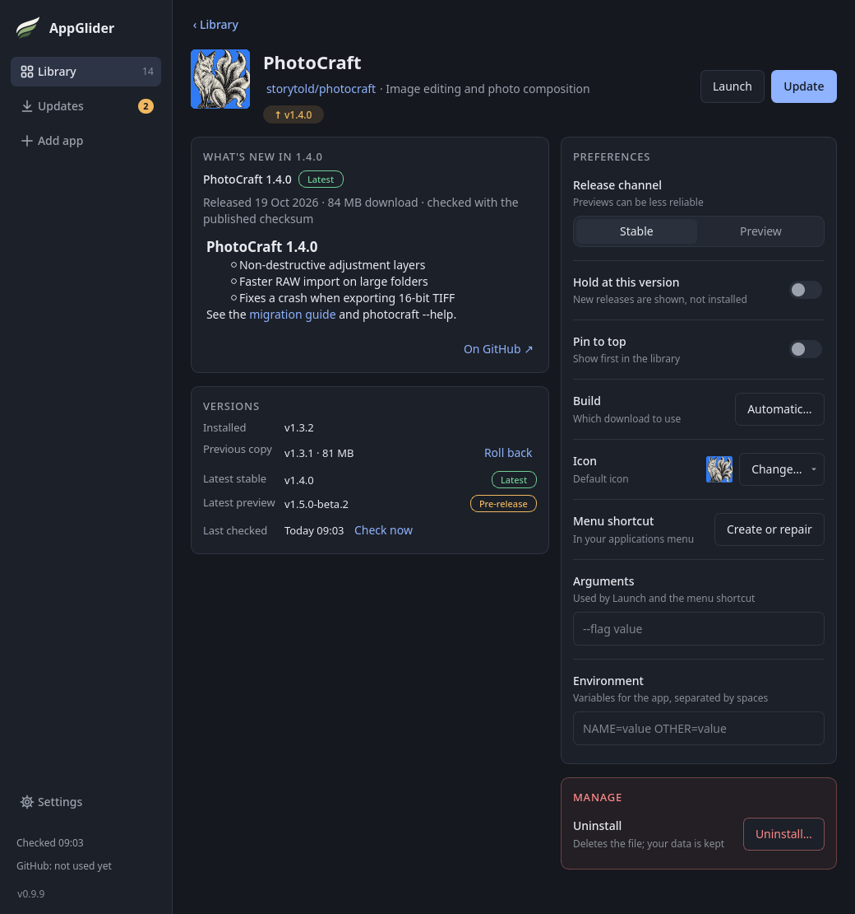
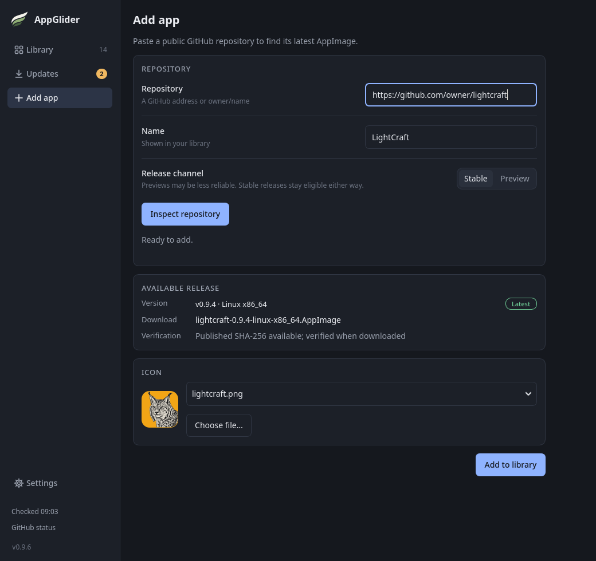
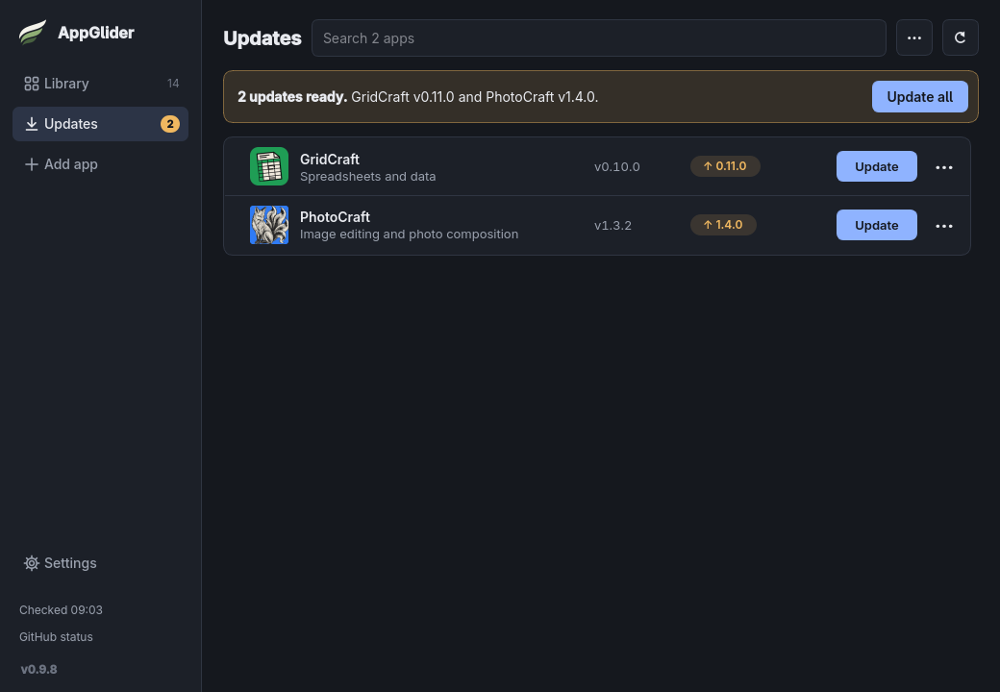
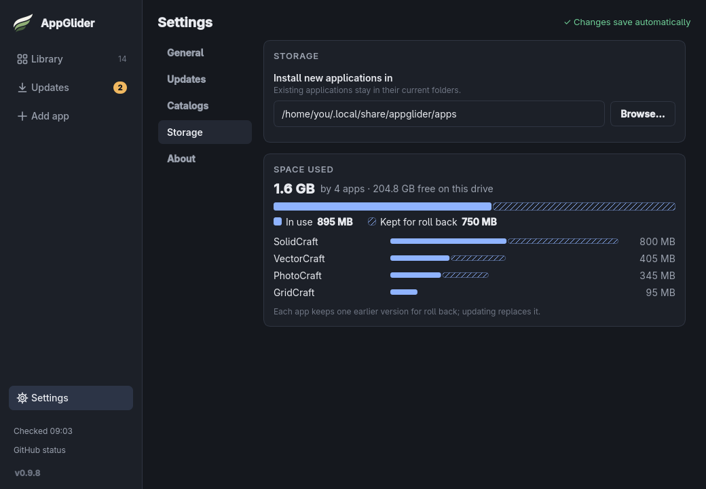

  

<h1 align="center">AppGlider</h1>

  <strong>Install, update and launch AppImage apps on Linux, from one window.</strong>

  
  
  
  

  <a href="https://github.com/Vyrnexis/AppGlider/releases/latest"><strong>Download</strong></a> ·
  <a href="https://appglider.org/docs/first-app/">Quick start</a> ·
  <a href="https://appglider.org/docs/">User guide</a> ·
  <a href="https://appglider.org/">Website</a>

<em>The Library in the Dark theme. The versions shown are made up.</em>

## Why AppGlider?

An AppImage is an app packed into a single file that runs on most Linux distributions without being installed the usual way. They are handy, but they do not update themselves or appear in your menu. AppGlider takes care of that: it downloads apps from their GitHub pages, checks each download is intact, adds them to your application menu and tells you when a new version is out.

- Add any public GitHub repository that publishes AppImages, and install it with one button. Every download is checked against the checksum the project published.
- Stay up to date: scheduled checks, release notes, **Update all**, stable versions by default, and a kept previous version to roll back to.
- Fits your desktop: menu entries, a tray icon, light and dark themes, and your own order for the list.
- Share your list as a plain text [catalog](https://appglider.org/docs/catalogs/).

AppGlider only manages the apps it installed itself. AppImages you already have, and apps from other launchers, are left alone.

## Screenshots

<table>
  <tr>
    <td width="50%"></td>
    <td width="50%"></td>
  </tr>
  <tr>
    <td align="center"><strong>An app's page</strong>: release notes, versions and preferences</td>
    <td align="center"><strong>Add app</strong>: paste a GitHub address and check it first</td>
  </tr>
  <tr>
    <td width="50%"></td>
    <td width="50%"></td>
  </tr>
  <tr>
    <td align="center"><strong>Updates</strong>: everything waiting, in one list</td>
    <td align="center"><strong>Storage</strong>: the space your apps use</td>
  </tr>
</table>

## Get AppGlider

1. Download the latest `AppGlider-…-x86_64.AppImage` from the [Releases page](https://github.com/Vyrnexis/AppGlider/releases/latest).
2. Make it runnable: right-click it, open **Properties → Permissions** and tick **Allow executing as a program**, or run `chmod +x AppGlider-*.AppImage` in a terminal.
3. Double-click it, or run it from a terminal.

You need a 64-bit (x86_64) Linux desktop about as new as Ubuntu 22.04 or newer. See [Install AppGlider](https://appglider.org/docs/install/) for the details, including Nix and NixOS, and [Your first app](https://appglider.org/docs/first-app/) for what to do next.

## Documentation

- [User guide](https://appglider.org/docs/): a quick start, a tour of the window and everything AppGlider can do.
- [Troubleshooting](https://appglider.org/docs/troubleshooting/): what to try when something goes wrong.
- [Catalogs](https://appglider.org/docs/catalogs/): share a list of apps, or import the community catalog.
- [How it works](https://appglider.org/docs/release-checks/): release checks, GitHub requests, files and security.
- [Changelog](https://appglider.org/docs/changelog/) and [roadmap](https://appglider.org/docs/roadmap/).
- [Questions and ideas](https://github.com/Vyrnexis/AppGlider/discussions): ask in Discussions.
- [Report a problem](https://github.com/Vyrnexis/AppGlider/issues/new/choose): the form asks for what is needed to fix it.

## For developers

AppGlider is written in Python with PySide6 and needs Python 3.11 or newer.
[Development and packaging](docs/development.md) covers setup, checks and building the
AppImage, [GitHub Actions](docs/builds.md) covers automated builds and releases, and the
[design brief](docs/design.md) covers the interface. Want to help? Read
[Contributing](CONTRIBUTING.md) first; it explains what fits AppGlider and how to get a pull
request merged.

## History

AppGlider was called AppHarbour until version 0.3.0. The name had to change because it was
already taken. Version 0.4.0 and later start with a fresh library and settings.

## Licence and credits

Copyright (C) 2026 Vyrnexis

AppGlider is free software: you can redistribute and/or modify it under the terms of the
GNU General Public License version 3, or (at your option) any later version. It is
distributed WITHOUT ANY WARRANTY. See [LICENSE](LICENSE) for details.

Releases up to and including 0.9.2 were published under the MIT licence and remain so.
Later releases are GPL-3.0-or-later.

The interface is original to this project. Application icons belong to their projects; see
[ATTRIBUTION.md](ATTRIBUTION.md) for their sources and licences. The libraries bundled in
the AppImage have their own [licences and source links](THIRD_PARTY_NOTICES.md).
