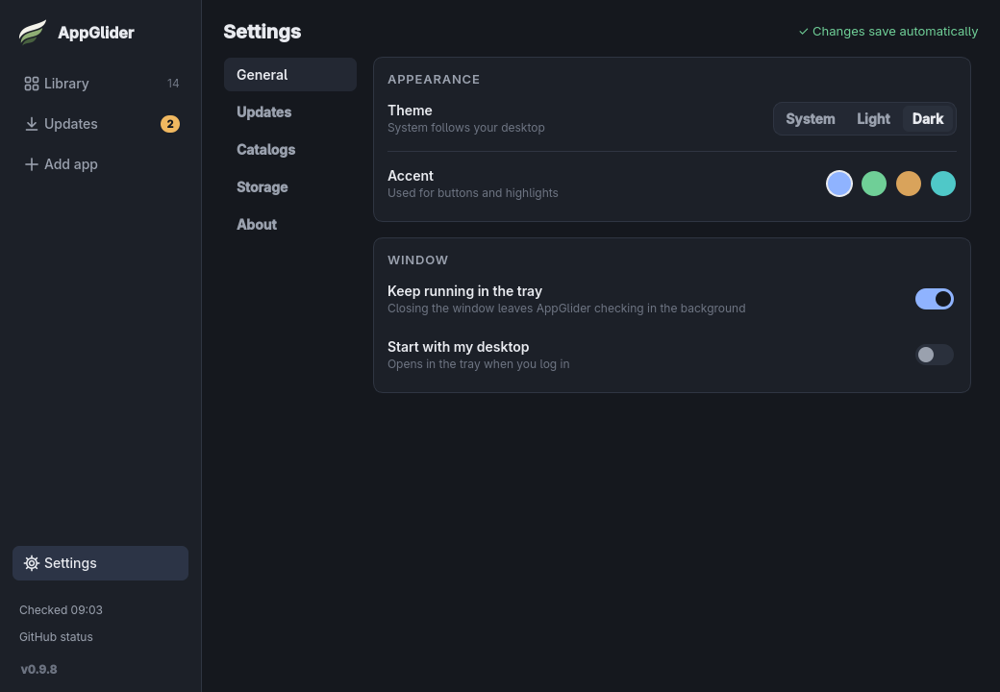

# Catalogs: sharing a list of apps

A catalog is a plain text file that lists apps. Use it to add many apps at once, to back up your list, or to share it with a friend.

## Where to find it

Open **Settings**, then **Catalogs**. There are four things you can do there.



- **Example catalog** adds the built-in list of the ArtCraft apps and SolidCraft. The same file is [`artcraft.toml`](catalogs/artcraft.toml), also attached to each release.
- **Import catalog…** adds the apps from a catalog file on your computer.
- **Import from an address** adds the apps from a catalog file on GitHub.
- **Export catalog…** saves your own list to a file.

## Import from a file

Choose **Import catalog…** and pick a catalog file. AppGlider first shows what it would add, and adds nothing until you confirm. If everything in the file is already in your list, the preview just has a **Close** button. The result is shown under the buttons as well as in the footer.

## Import from an address

Paste a link to the file's page on github.com, such as the one below, or its raw link, and press **Import**. You see the preview first, just as with a file.

```text
github.com/owner/repo/blob/main/apps.toml
```

> [!TIP]
> Link to the file itself, not to the repository. A link to the repository's front page has no list in it.

## The community catalog

The community catalog is a shared list that anyone can add an app to by pull request. To use it, paste this address into **Import from an address**:

```text
https://github.com/Vyrnexis/AppGlider/blob/main/docs/catalogs/community.toml
```

The file itself is [`catalogs/community.toml`](catalogs/community.toml). To add an app of your own, see [Contributing](../CONTRIBUTING.md#add-an-app-to-the-community-catalog).

## What importing does

- Importing only adds apps to your list. Nothing is downloaded until you press **Install**.
- Apps you already have are never changed.
- If some entries have a problem, AppGlider skips them, says why, and imports the rest.

The checks made on a file are described in [Files and folders](how-it-works/files-and-folders.md#catalog-files).

## Export your list

Choose **Export catalog…** to save your own list to a file. You can keep it as a backup or send it to a friend, who can then import it.

> [!NOTE]
> An export never includes the launch options you set for an app, because a variable can hold a password. [Install commands](using/install-commands.md) are not included either, and neither are apps added from a file.

## The file format

A catalog is easy to read and to write yourself. This is the whole format:

```toml
# lines starting with # are notes for people
format = 1
name = "My catalog"

[[app]]
repo = "owner/project"            # required: owner/project or the full GitHub address
name = "Project"                  # optional: the name shown in your library
description = "What it does"      # optional: up to 200 characters
stable_only = true                # optional: false also offers previews
build = "Project-x86_64.AppImage" # optional: the exact AppImage file to prefer
```

The first lines describe the catalog. Add one `[[app]]` block for each app.

| Field | Needed? | What it does |
| --- | --- | --- |
| `repo` | Yes | The app's GitHub repository, as `owner/project` or the full GitHub address. |
| `name` | No | The name shown in your library. |
| `description` | No | A short line about the app, up to 200 characters. |
| `stable_only` | No | `true` offers stable releases only (the default). `false` also offers previews. |
| `build` | No | The exact AppImage file to prefer when a release has several. |
