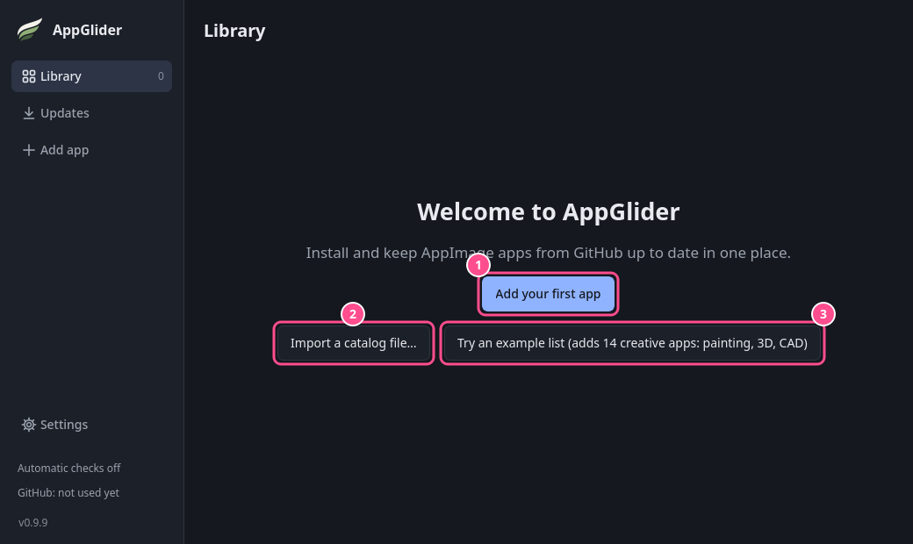

# Your first app

A new AppGlider library is empty. This page walks you through adding an app, installing it and launching it.

## Add some apps

A new library shows a welcome screen:

1. **Add your first app** adds one app from its GitHub address. See [Adding apps](../using/adding-apps.md).
2. **Import a catalog file…** adds a whole list of apps from a file. See [Catalogs](../catalogs.md).
3. **Try an example list** adds a ready-made list of creative apps (painting, 3D and CAD: the ArtCraft apps and SolidCraft), a good way to try AppGlider.

Until you have added something, the welcome screen hides the search, filters and the refresh button, since there is nothing to search or check yet.

> [!NOTE]
> Adding an app only puts it on your list. Nothing is downloaded yet. The project needs a published release with an AppImage file and a published checksum.

## Install

Press **Install** on an app's row. AppGlider downloads it, checks it and adds it to your application menu. You can click the row at any time to open the app's page.

## Launch

Press **Launch** on the row, or start the app from your application menu like any other program. Its menu entry is named after the app, like **PhotoCraft**. "(AppGlider)" is added only when another menu entry already has that name.

That is all you need. AppGlider checks for updates by itself and shows an **Update** button when a new version is out. To find your way around the window, see [A tour of the window](../using/window.md).
