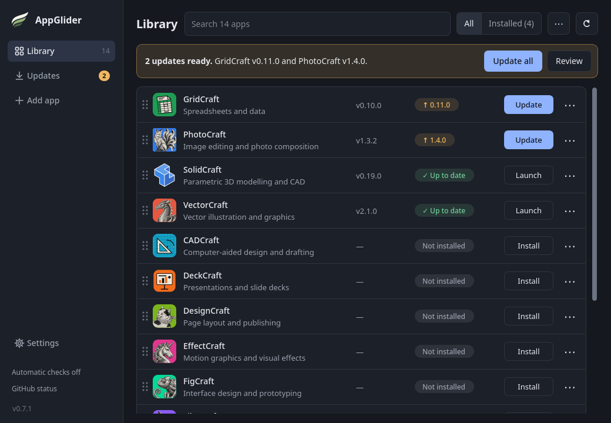
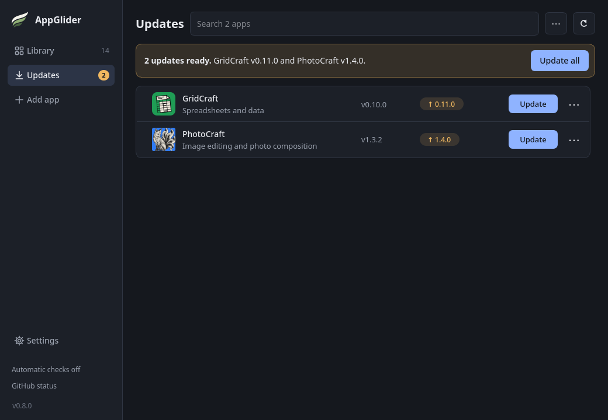
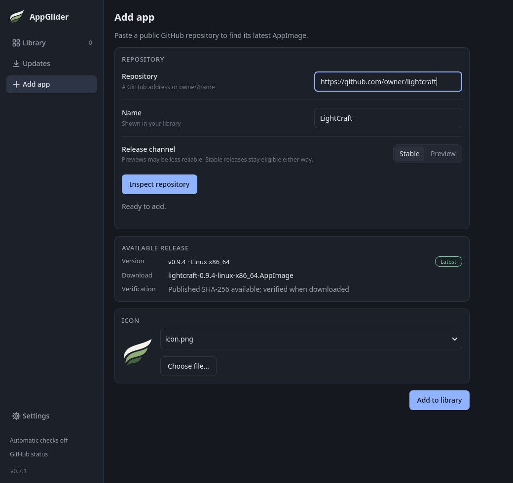
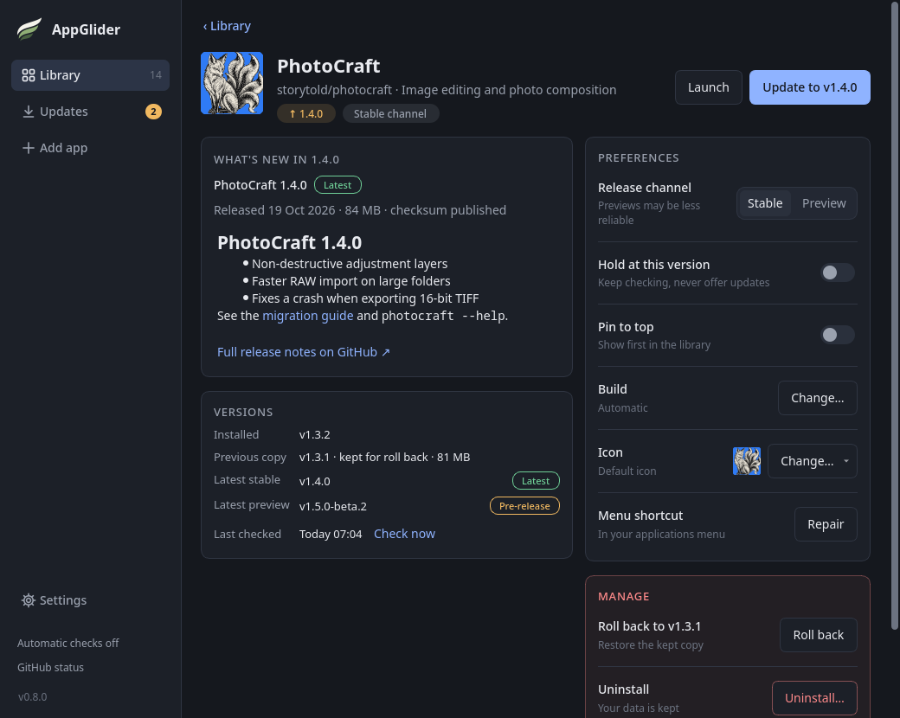
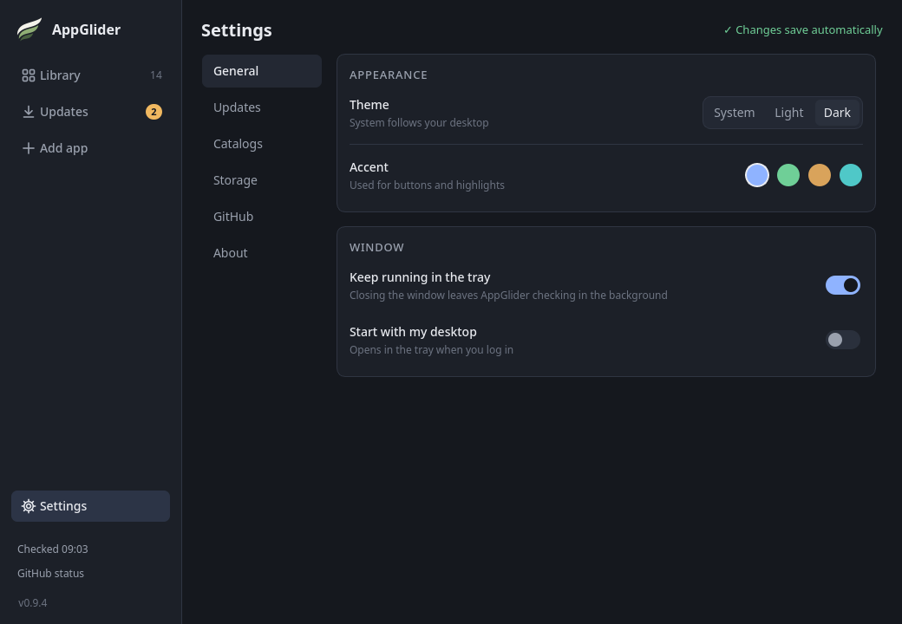

# AppGlider user guide

AppGlider keeps your AppImage apps in one place. It downloads them from their GitHub
pages, checks they arrived intact, adds them to your application menu and tells you when a
newer version is out. If you want the "how does it actually work" details, see the
[technical notes](technical-notes.md).

## Contents

- [The window](#the-window)
- [Keyboard](#keyboard)
- [Adding apps](#adding-apps)
- [Installing and launching](#installing-and-launching)
- [Updates](#updates)
- [Stable versions and previews](#stable-versions-and-previews)
- [The app's page](#the-apps-page)
- [Choosing a build](#choosing-a-build)
- [Holding a version](#holding-a-version)
- [Icons](#icons)
- [Catalogs: sharing a list of apps](#catalogs-sharing-a-list-of-apps)
- [Settings](#settings)
- [The tray icon](#the-tray-icon)
- [Menu shortcuts](#menu-shortcuts)
- [Uninstalling](#uninstalling)
- [If something goes wrong](#if-something-goes-wrong)

## The window

A new library is empty. You will see a welcome message with **+ Add app**, **Import
catalog…** and **Example catalog**.



**The sidebar** on the left is always there:

- **Library** lists every app, with the number of apps you have.
- **Updates** lists only the apps with an update waiting. An amber badge shows how many.
- **Add app** opens the page for adding a repository.
- **Settings** opens AppGlider's own settings. It sits at the bottom, above two small status
  lines: when updates were last checked (and when the next scheduled check is due), and how
  much of GitHub's request allowance is left. Clicking that block opens
  **Settings → GitHub**; the version number below it opens **Settings → About**.

**The Library page** has a search box (it matches names, descriptions and repository names),
an **All / Installed (N)** switch, a **⋯ Library options** menu and a round-arrow button that
checks for updates. When updates are waiting, a banner offers **Update all** and **Review**, which
opens the Updates page. The Updates page is the same list limited to apps with an update,
with the same banner and **Update all**.



**Rows.** Each app is a row: its icon, name and a one-line description, the installed
version, a status chip, one main button and a **⋯** menu. Clicking anywhere on a row (or
its name) opens the app's page. The chip says what is going on:

| Chip | Main button | Meaning |
| --- | --- | --- |
| ✓ Up to date | Launch | You have the newest eligible version |
| ↑ 1.4.0 | Update | A newer version is waiting |
| Choose build | Choose build | Several builds fit; see [Choosing a build](#choosing-a-build) |
| ‖ Held · 2.3.0 out, or ‖ Held | Launch | The app is [held](#holding-a-version) |
| Preview channel | Launch | The installed copy is a preview |
| Check failed | Launch | The last check failed; the last known information is kept |
| Not installed | Install | In your library but not downloaded yet |
| Installing… / Updating… | Cancel | Work is in progress |

Colour is never the only signal: every chip also has a word or symbol, and hovering over it
explains it. The **⋯** menu has quick actions: Open details, Launch, Open repository, Pin to
top, Move up and Move down (see below), Hold at current version, Create/repair menu
shortcut, Roll back to previous version and Uninstall…. Everything else is on the app's
page.

**Order, pinning and your own order.** There is one order: yours. Until you change it the
apps are A–Z by name, and an app you add later appears at the end. **⋯ → Pin to top** puts an
app at the front (it gets a gold ★ beside its name), and **Unpin** puts it back. To reorder,
drag a row up or down by the dotted handle at its left edge; a line shows where it will land.
**⋯ → Move up** and **Move down** do the same without a mouse. Reordering works on the Library
page with **All** or **Installed** selected and an empty search, never on Updates. With
**Installed** selected, an app moves relative to the rows you can see and the apps not shown
keep their places. Pinned apps always stay above the others. **⋯ → Sort A–Z** in the toolbar
(next to the update check button) replaces your order with A–Z after you confirm; pinned apps
stay on top. The tray menu's list of installed apps follows the same order.

**Messages.** The bottom of the window stays empty until there is something to say: a result
("Updated 1 apps."), a progress bar with **Cancel** while something downloads, or a
**Review N unrecognised entries…** button. Results fade away after a while.

## Keyboard

Everything can be done from the keyboard. **Tab** moves through the sidebar, the toolbar,
the banner and then the rows; the focused control has a blue (accent-coloured) outline.
**Enter** or **Space** on an app's name opens its page, **Ctrl+F** jumps to the search box
from any page, and **Esc** goes back from an app's page or the Add app page.

## Adding apps

AppGlider installs apps from public GitHub repositories. There are two ways to fill your
library.

**One at a time**

1. Choose **Add app** in the sidebar.
2. Paste the repository's address, such as `https://github.com/owner/project`, and give it
   a name if you like.
3. Leave **Release channel** on **Stable** unless you want to try previews.
4. Choose **Inspect repository** (or press Enter). AppGlider looks at the latest release and
   shows what it found: the version, the file it would download, whether a checksum is
   published, and a choice of icons. If several builds fit, a **Build variant** box asks
   which one you want.
5. Choose **Add to library**. This only creates a row. It does not install anything yet.
   AppGlider then opens the new app's page.



Leaving the page while a search runs cancels it.

The project needs a published release with an AppImage file and a published checksum. If
something is missing, AppGlider tells you what.

**From a catalog**: see [Catalogs](#catalogs-sharing-a-list-of-apps) below.

## Installing and launching

Press **Install** on an app's row (or on its page). AppGlider downloads the version that matches your
processor, checks it against the checksum the project published, makes sure it is a proper
AppImage, and adds an entry to your application menu such as **PhotoCraft (AppGlider)**.
After that the row shows **Launch**.

Installed apps work offline. If an app fails to start, AppGlider shows where its log file
is.

AppGlider only manages apps it installed itself. AppImages you downloaded some other way,
or installed with another launcher, are left alone.

## Updates

The round-arrow button (**Check for updates**) on the Library and Updates pages, and
**Check for updates** in the tray menu, check the apps you have installed to see whether
newer versions exist. They do not download anything. When an update is available, the row
shows the new version with an **Update** button, and the banner offers **Update all**. Held
apps are left out.

An app's page shows **What's new**, the release notes of the version on offer, so you can
read them before updating. If the project published none, a link opens its releases on
GitHub.

AppGlider also checks by itself:

- when it starts, and
- on a schedule while it is running, including while it sits in the tray. Choose how often
  under **Settings → Updates → Check for updates**: every hour, 3, 6 (the default), 12 or 24
  hours, or **Only when I choose** if you would rather do it yourself.

Checks only happen while AppGlider is running. When at least one update is waiting, the
tray icon gets an amber badge with an up arrow, and its tooltip says how many ("AppGlider ·
Updates: 2").

**Desktop notifications (optional).** Turn on **Settings → Updates → Notify me about new
updates** and AppGlider also pops up a message when a
scheduled check finds an update you have not been told about yet, such as "PhotoCraft 1.1.0
is available." Several updates are combined into one message, you are told once for each new
version, and nothing appears while you are looking at the AppGlider window or when you press
**Check for updates** yourself. Clicking the message opens AppGlider. It is off by default,
and it needs a system tray; whether and how your desktop shows the message is up to your
desktop.

GitHub lets programs make about 60 anonymous requests an hour. AppGlider is careful with
them: to find out whether an app you have installed has a newer version, it first looks at
the app's ordinary GitHub release page (or, for apps with previews turned on, its public
release feed), which does not use up that allowance. It only uses the allowance when a new
version has really appeared, or when you install, add or inspect an app. AppGlider skips scheduled checks when GitHub says few requests are left. The status block
at the bottom of the sidebar shows how many remain. No GitHub account or
token is needed.

**Roll back.** AppGlider normally keeps the previous version of each app. If a new version
misbehaves, use **⋯ → Roll back to previous version**, or **Roll back** under **Manage** on the app's page, which also shows the size of the kept copy. A download that fails or is
cancelled never replaces the version you already have.

## Stable versions and previews

Projects often publish test versions ("beta", "preview") ahead of the real thing. By
default AppGlider only offers **stable** releases. To include previews for an app, open its
page and set **Release channel** to **Preview** under **Preferences**. The page's **Check
now** (under **Versions**) shows what that would give you without installing anything.



- Green **Latest** badges mark the project's latest stable release. Amber **Pre-release**
  badges mark previews.
- If you turn previews off again, an installed preview keeps working, and AppGlider waits
  for a newer stable release. It never silently downgrades you. **Roll back** is the way
  to go back on purpose.

## The app's page

Click an app's row to open its page; **‹ Library** (or **Esc**) returns to the list as you
left it. The header has the icon, name, repository, description, status chips and the
buttons **Launch** and the main action (Install, Update, Choose build or Cancel). Below it:

- **What's new**: the release notes of the offered version, with its date and size.
- **Versions**: the installed version, the previous copy kept for rolling back (with its
  size), the latest stable and preview versions, and when they were last checked
  (**Check now** looks again).
- **Preferences**: **Release channel**, **Hold at this version**, **Pin to top**, **Build**,
  **Icon** and **Menu shortcut** (**Repair**). Changes apply immediately.
- **Manage** (in red): **Roll back**, **Uninstall…** and **Remove…** from the library.
  Each asks before it does anything. Uninstalling keeps your documents and the app's own
  settings. An app must be uninstalled before it can be removed from the library, and
  removing it deletes no files.

## Choosing a build

Some projects publish several AppImages for the same version, for example one for Ubuntu
22.04 and one for 24.04. When AppGlider cannot tell which one you need, a **Build variant**
choice appears when you add the app. Pick the one that suits your system, following that
project's own advice. AppGlider cannot tell which distribution you run. Your choice is
remembered for later updates. To change it, open the app's page and use **Preferences →
Build → Change…**.

If the project later renames its files so AppGlider can no longer tell which build you
meant, the row shows **Choose build**. Your installed copy keeps working, and nothing
changes until you choose.

## Holding a version

To keep an installed app where it is, switch on **Hold at this version** on its page (or
use **⋯ → Hold at current version**). AppGlider still checks a held app, but it never
offers an update, counts it, notifies you or includes it in **Update all**; the row says
"Held" and shows which version is waiting. Switch the hold off (or choose **Release
hold**) to update again. The hold is removed when you uninstall the app.

## Icons

AppGlider looks for an icon in the project's repository when you add it. This normally takes
a second or two. If GitHub's request allowance is low it browses the project's web pages
instead, which uses none of the allowance and usually takes 5 to 10 seconds (up to about 20 for
some big projects). While it works you will see a moving bar and a message such as "Looking
through OrcaSlicer's folders… 7 pages so far", so you can tell it has not stopped. To stop it,
leave the page. You can pick one
of the candidates it finds, or **Choose file…** to use your own PNG or SVG file. To change
an app's icon later, open its page and use **Preferences → Icon → Change…**, then **Find
online**, **Choose file…** or **Use the default icon**. Icons are saved on your computer and work offline.
If there is no icon, AppGlider's own is used. Apps from the example catalog come with their
icons.

## Catalogs: sharing a list of apps

A catalog is a plain text file that lists apps. Open **Settings → Catalogs**, then use **Import
catalog…** to add everyone on a list at once, or **Export catalog…** to save your own list,
perhaps to back it up or share it.

A ready-made example list of the ArtCraft apps and SolidCraft is built in: choose **Example
catalog** on the welcome screen, or **Example catalog** in **Settings → Catalogs**. The same file is [`catalogs/artcraft.toml`](catalogs/artcraft.toml), also
attached to each release, if you want to read it or use it as a model for your own.

- **You see a preview first.** Importing only adds apps to your library as rows. Nothing
  is installed or downloaded until you press **Install**.
- **Your existing apps are never changed.** If a catalog lists something you already have,
  it is left exactly as it is.
- **It is just a text file.** You can open one in any text editor to see what it does, or
  write your own. Here is the whole format:

```toml
# lines starting with # are notes for humans
format = 1
name = "My catalog"

[[app]]
repo = "owner/project"            # required: owner/project or the full GitHub address
name = "Project"                  # optional: the name shown in the library
description = "What it does"      # optional: up to 200 characters
stable_only = true                # optional: false also offers previews
build = "Project-x86_64.AppImage" # optional: the exact AppImage file to prefer
```

If a catalog has a problem, AppGlider tells you which entries it skipped and why, and
imports the rest. A file that is not a proper catalog adds nothing at all.

## Settings

Open **Settings** (bottom of the sidebar). It is a page in the main window with a list of
sections on the left. Everything saves as you change it, so there is no Save or Cancel; the
page says "Changes save automatically".

- **General**: **Theme** (System, Light or Dark), **Accent** (Blue, Green, Amber or Clay) and
  whether closing the window keeps AppGlider running in the tray.
- **Updates**: how often to check for updates, and whether to **Notify me about new
  updates**.
- **Catalogs**: import a catalog, add the example catalog, or export your own.
- **Storage**: the folder new apps are installed into.
- **GitHub**: how many requests GitHub reports as remaining (no requests are made).
- **About**: the version and project links.



**Theme** System (the default) follows your desktop's light or dark setting. The window
changes as you pick, so you can try them out. If you used the older Forest, Earthy or
Sandstone themes, AppGlider now shows them as Dark with a Green, Clay or Amber accent.

Changing the install folder (under **Storage**) only affects new installs. Apps you already installed stay where
they are and keep updating there. The new folder is used once you finish typing it or choose it with **Browse…**.

## The tray icon

If your desktop has a system tray, AppGlider sits in it. Click the icon to bring back the
window. Right-click for **Open AppGlider**, **Check for updates**, your installed apps and
**Quit AppGlider**.

Closing the window hides it to the tray and downloads carry on in the background. If you
would rather closing quit the program, turn off **Keep running in the tray** in **Settings → General**. Without a
working tray, closing the window just quits. To really exit while it is in the tray, use
**Quit AppGlider**.

Only one AppGlider window runs at a time. Starting it again just shows the one that is
already open.

## Menu shortcuts

AppGlider adds an entry to your application menu for itself and for every app it installs,
named like **PhotoCraft (AppGlider)**. If one goes missing, use **⋯ → Create/repair menu
shortcut** (or **Repair** on its page).

Some apps add their own menu entry the first time you run them, without "(AppGlider)" in the
name. That is the app's doing, not AppGlider's, so such an app can appear twice in your
menu. They both start the same program. When you uninstall the app through AppGlider, its
own entry is removed too, so no dead entry is left behind.

## Uninstalling

**⋯ → Uninstall…** removes the app and its menu entries. Your documents and the app's
own settings stay. You cannot uninstall an app while it is running. To remove an app from
the list as well, uninstall it first, then use **Remove…** under **Manage** on its page.

## If something goes wrong

**AppGlider will not start, and the message mentions FUSE.** Run it with
`--appimage-extract-and-run` added, for example
`./AppGlider-*.AppImage --appimage-extract-and-run`.

**The menu entry stopped working.** You probably moved the AppImage file. Start AppGlider
from its new location once and it repairs the entry.

**There is no tray icon.** Some desktops need an extension for tray icons (GNOME is the
usual example). AppGlider still works without one; closing the window then just quits it.

**"Review N unrecognised entries…" appears at the bottom.** AppGlider found installed apps
that are not in your repository list, for example apps installed before you imported the
example catalog. Importing the catalog usually makes them match again. You can also tick the
ones you want AppGlider to forget. Nothing on your disk is deleted.

**A project cannot be added.** AppGlider needs a published release with an AppImage file
and a published checksum, and it will say which is missing. Projects that only publish
test versions need previews turned on first.

**The GitHub status in the sidebar says few requests remain.** You have used up most of GitHub's anonymous
allowance for the hour. It resets on its own. Scheduled checks pause meanwhile.

**An app will not run.** Apps installed through AppGlider are the project's own AppImages,
and they may need libraries your system lacks. Check the project's page for its
requirements.
