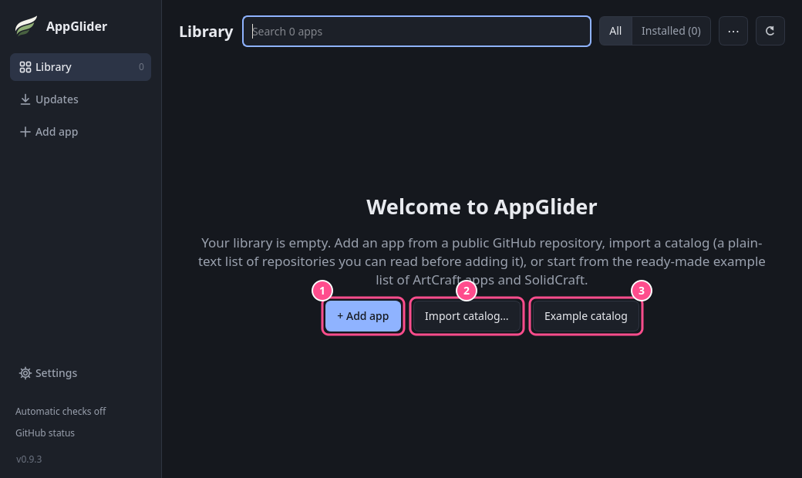
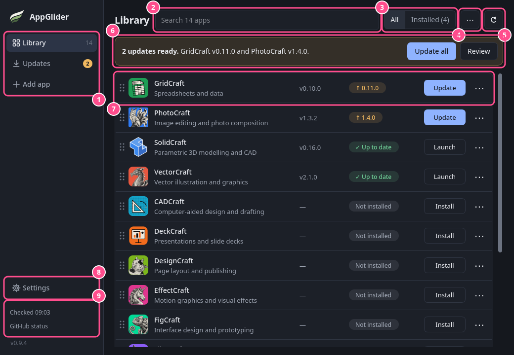
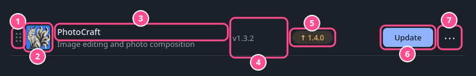
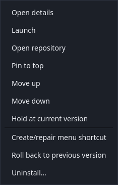
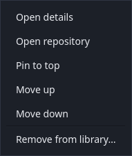
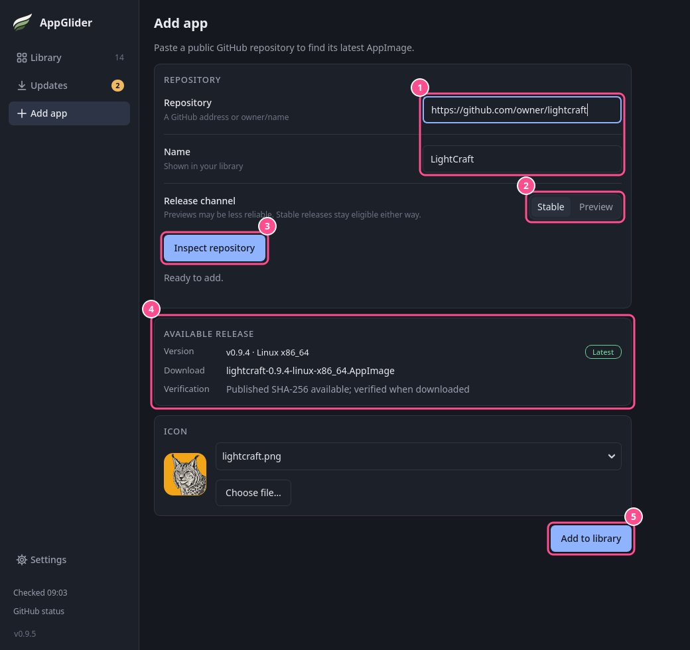
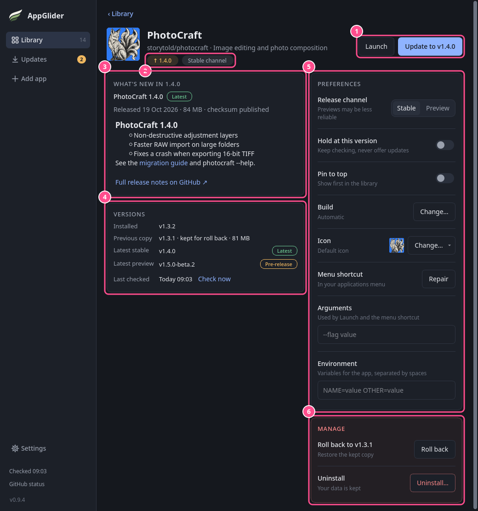
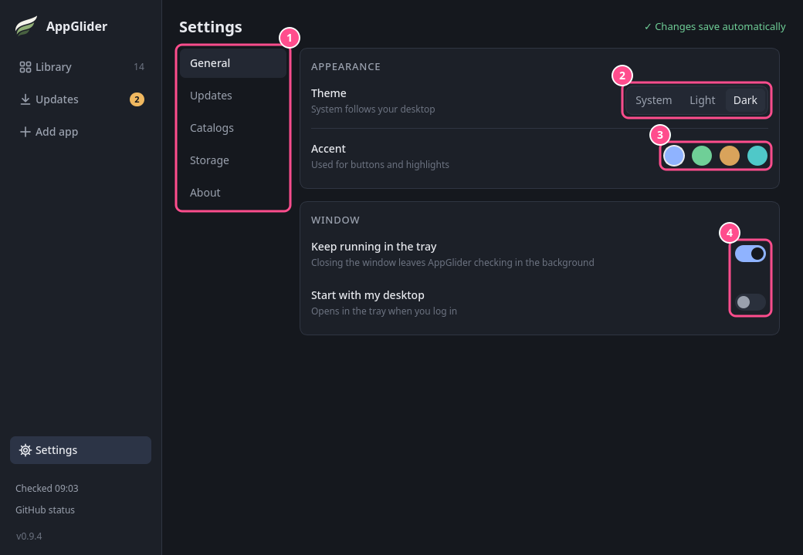
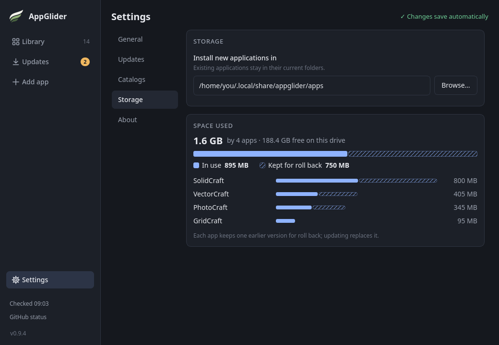
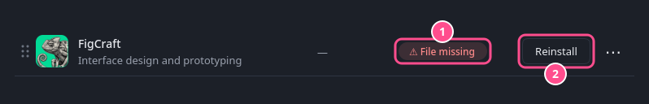

# AppGlider user guide

AppGlider keeps your AppImage apps in one place. It downloads them from their GitHub pages,
checks that each download arrived intact, adds them to your application menu and tells you
when a new version is out.

New to AppGlider? Start with the [quick start](#quick-start), then come back to the other
sections when you need them. Behind-the-scenes details are in the
[technical notes](technical-notes.md).

## Contents

**Getting started**

- [Quick start](#quick-start)
- [A tour of the window](#a-tour-of-the-window)
- [Adding apps](#adding-apps)
- [Installing and launching](#installing-and-launching)

**Everyday use**

- [Keeping apps up to date](#keeping-apps-up-to-date)
- [The app's page](#the-apps-page)
- [Uninstalling, forgetting and removing](#uninstalling-forgetting-and-removing)

**Choices for each app**

- [Stable versions and previews](#stable-versions-and-previews)
- [Choosing a build](#choosing-a-build)
- [Holding a version](#holding-a-version)
- [Icons](#icons)
- [Launch options](#launch-options)

**AppGlider itself**

- [Settings](#settings)
- [Catalogs: sharing a list of apps](#catalogs-sharing-a-list-of-apps)
- [Updating AppGlider](#updating-appglider)
- [The tray icon](#the-tray-icon)
- [Starting with your desktop](#starting-with-your-desktop)
- [Menu shortcuts](#menu-shortcuts)
- [Keyboard](#keyboard)

**Help**

- [When an app's file goes missing](#when-an-apps-file-goes-missing)
- [If something goes wrong](#if-something-goes-wrong)

## Quick start

1. **Get AppGlider.** Download `AppGlider-…-x86_64.AppImage` from the
   [Releases page](https://github.com/Vyrnexis/AppGlider/releases/latest) and keep it
   somewhere permanent, such as `~/Applications`.
2. **Make it runnable.** Right-click the file, open **Properties → Permissions** and tick
   **Allow executing as a program**, or run `chmod +x AppGlider-*.AppImage` in a terminal.
   Then double-click it.
3. **Add some apps.** A new library is empty, so AppGlider shows a welcome screen:

   

   1. **+ Add app** adds one app from its GitHub address. See [Adding apps](#adding-apps).
   2. **Import catalog…** adds a whole list of apps from a file. See
      [Catalogs](#catalogs-sharing-a-list-of-apps).
   3. **Example catalog** adds a ready-made list of the ArtCraft apps and SolidCraft, a
      good way to try AppGlider.

   Adding an app only puts it on your list. Nothing is downloaded yet.
4. **Install.** Press **Install** on an app's row. AppGlider downloads it, checks it and
   adds it to your application menu.
5. **Launch.** Press **Launch** on the row, or start the app from your application menu like
   any other program. Its menu entry is named like **PhotoCraft (AppGlider)**.

That is all you need. AppGlider checks for updates by itself and shows an **Update** button
when a new version is out.

## A tour of the window



1. **Library, Updates and Add app.** **Library** lists every app (the number is how many
   you have). **Updates** lists only the apps with an update waiting; the amber badge says
   how many. **Add app** opens the page for adding an app.
2. **Search** matches app names, descriptions and repository names. **Ctrl+F** jumps here
   from any page.
3. **All / Installed** shows every app, or only the ones you have installed.
4. **Library options** (**⋯**) holds **Sort A–Z**.
5. **Check for updates** looks for new versions of your installed apps now.
6. **The updates banner** appears when updates are waiting. **Update all** installs them
   all; **Review** opens the Updates page.
7. **A row** for each app. Click anywhere on it (except its buttons) to open the
   [app's page](#the-apps-page).
8. **Settings** opens AppGlider's own [settings](#settings).
9. **The status block** shows when updates were last checked, when the next check is due and
   how much of GitHub's allowance is left. Hover over it for details, or click it to choose
   how often to check. The version number below it opens **Settings → About**.

The bottom of the window stays empty until there is something to say: the result of
something you did ("Updated 2 apps."), or a progress bar with **Cancel** while something
downloads. Results fade away after a while.

### Rows



1. **Drag handle.** Drag the row up or down to put your apps in your own order.
2. **Icon.**
3. **Name and description.** A gold ★ beside the name means the app is pinned to the top.
4. **Installed version**, or **—** when it is not installed.
5. **Status chip**: what is going on with the app (see the table below).
6. **Main button**: the thing you most likely want to do next.
7. **⋯ menu**: more actions for this app.

| Chip | Main button | What it means |
| --- | --- | --- |
| ✓ Up to date | Launch | You have the newest version on offer |
| ↑ 1.4.0 | Update | A newer version is waiting |
| Choose build | Choose build | Several downloads fit; see [Choosing a build](#choosing-a-build) |
| ‖ Held, or ‖ Held · 2.3.0 out | Launch | The app is [held](#holding-a-version) at its version |
| Preview channel | Launch | The installed copy is a preview version |
| Check failed | Launch | The last check failed; what was known before is kept |
| ⚠ File missing | Reinstall | The app's file was moved or deleted; see [below](#when-an-apps-file-goes-missing) |
| Not installed | Install | On your list but not downloaded yet |
| Installing… / Updating… | Cancel | Work is in progress |

Every chip has a word or symbol as well as a colour, and hovering over it explains it.

### The ⋯ menu

The menu only offers what makes sense for the app right now:

| An installed app | An app that is not installed |
| --- | --- |
|  |  |

**Roll back to previous version** appears when AppGlider kept an earlier copy, and **Move
up** and **Move down** appear while the list can be reordered. An app whose file went
missing also offers **Forget missing copy…**. While AppGlider is busy installing or updating
something, the menu's actions are greyed out until it finishes.

### Your own order and pinning

There is one order, and it is yours. At first the apps are sorted A–Z, and an app you add
later goes to the end.

- **Drag a row** by its handle to move it; a line shows where it will land. **⋯ → Move up**
  and **Move down** do the same from the keyboard.
- **⋯ → Pin to top** keeps an app above all the others; **Unpin** puts it back.
- **⋯ → Sort A–Z** in the toolbar puts everything back in A–Z order, after asking. Pinned
  apps stay on top.

Reordering works on the Library page with an empty search box, not on the Updates page.
With **Installed** selected, an app moves among the rows you can see and the hidden ones keep
their places. The tray menu lists your installed apps in the same order.

## Adding apps

AppGlider installs apps from public GitHub repositories. To add one:



1. Choose **Add app** in the sidebar and paste the repository's address, such as
   `https://github.com/owner/project`. You can change the **Name** it gets in your library.
2. Leave **Release channel** on **Stable** unless you want to try test versions
   ([previews](#stable-versions-and-previews)).
3. Choose **Inspect repository** (or press **Enter**).
4. AppGlider shows what it found: the version, the file it would download and whether the
   project published a checksum to check it with. Below that you can pick an icon. If
   several downloads fit, a **Build variant** box asks which one you want.
5. Choose **Add to library**. This puts the app on your list and opens its page. It does not
   download anything yet.

The project needs a published release with an AppImage file and a published checksum. If
something is missing, AppGlider tells you what. Leaving the page while it is still looking
cancels the search.

To add many apps at once, use a [catalog](#catalogs-sharing-a-list-of-apps).

## Installing and launching

Press **Install** on an app's row or its page. AppGlider:

1. downloads the version that matches your computer,
2. checks it against the checksum the project published, and that it really is an AppImage,
3. adds an entry to your application menu, named like **PhotoCraft (AppGlider)**.

The row then shows **Launch**. A download that fails or that you cancel leaves nothing
behind. Installed apps work offline. If an app fails to start, AppGlider tells you where to
find its log file.

AppGlider only manages the apps it installed itself. AppImages you downloaded some other way,
or installed with another program, are left alone.

## Keeping apps up to date

**How you find out.** AppGlider checks your installed apps for new versions when it starts,
and then every 6 hours while it is running (also while it sits in the tray). You can change
how often under **Settings → Updates**, or choose **Only when I choose**. To check right now,
press the round arrow in the toolbar, or **Check for updates** in the tray menu. Checking
never downloads anything.

When an update is waiting:

- the row shows the new version and an **Update** button,
- the banner at the top offers **Update all**,
- **Updates** in the sidebar and the tray icon get an amber badge.

**Read before you update.** An app's page shows **What's new**, the project's notes for the
new version.

**Notifications (optional).** Turn on **Settings → Updates → Notify me about new updates** to
get a desktop notification when a scheduled check finds something new. You are told once per
new version, several updates share one message, and nothing pops up while you are looking at
AppGlider. It needs a system tray.

**Roll back.** AppGlider keeps the previous version of each app. If a new version misbehaves,
use **⋯ → Roll back to previous version**, or **Roll back** under **Manage** on the app's page.

**GitHub's allowance.** GitHub lets programs without an account make about 60 requests an
hour. AppGlider is careful with them: a routine check reads the project's ordinary release
page first, which costs nothing, and only uses the allowance when a new version has really
appeared, or when you add, inspect or install an app. If few requests remain, scheduled
checks wait until GitHub resets the allowance. The status block in the sidebar shows what is
left. You do not need a GitHub account. The details are in the
[technical notes](technical-notes.md#how-release-checks-work).

## The app's page

Click an app's row to open its page. **‹ Library** (or **Esc**) takes you back to the list as
you left it.



1. **Launch**, and the main action: Install, Update, Choose build, Reinstall or Cancel.
2. **Status chips**: the app's state and its release channel.
3. **What's new**: the release notes of the version on offer, with its date and size, and a
   link to the full notes on GitHub.
4. **Versions**: the installed version, the earlier copy kept for rolling back, the newest
   stable and preview versions, and when they were last checked. **Check now** looks again.
5. **Preferences** for this app. Changes apply straight away.
   - **Release channel**: see [Stable versions and previews](#stable-versions-and-previews).
   - **Hold at this version**: see [Holding a version](#holding-a-version).
   - **Pin to top**: keep the app at the top of the list.
   - **Build**: see [Choosing a build](#choosing-a-build).
   - **Icon**: see [Icons](#icons).
   - **Menu shortcut → Repair**: recreate the app's menu entry.
   - **Arguments** and **Environment**: see [Launch options](#launch-options).

   **Hold at this version** and **Menu shortcut** appear once the app is installed.
6. **Manage** (in red): **Roll back** when an earlier copy is kept, and **Uninstall…**,
   **Forget…** or **Remove…** depending on the app's state. Each asks first. See
   [Uninstalling, forgetting and removing](#uninstalling-forgetting-and-removing).

## Uninstalling, forgetting and removing

There are three ways to let go of an app. Each asks before it does anything, and none of them
touches your documents or the app's own settings.

| Action | Offered when | What it does | The app stays on your list |
| --- | --- | --- | --- |
| **Uninstall…** | The app is installed | Deletes the app's file, the earlier copy kept for rolling back, and its menu entries | Yes, as Not installed |
| **Forget missing copy…** | The app shows ⚠ File missing | Stops tracking the missing file and removes its menu entry. Deletes no files | Yes, as Not installed |
| **Remove from library…** | The app is not installed, or its file is missing | Takes the app off your list, with its preferences and icon. Deletes no app files | No |

All three are in the row's **⋯** menu and under **Manage** on the app's page.

- **To get rid of an app completely:** **Uninstall…** it, then **Remove from library…**.
- **Forget or Remove?** **Forget** keeps the app on your list so you can install it again
  later. **Remove** takes it off the list altogether, and forgets a missing file too.

You cannot uninstall an app while it is running. Uninstalling also releases a
[hold](#holding-a-version).

## Stable versions and previews

Projects often publish test versions ("beta", "preview") before the finished one. AppGlider
offers only **stable** versions unless you ask for more. To include previews for one app,
open its page and set **Release channel** to **Preview**. **Check now** under **Versions**
shows what that would offer, without installing anything.

- A green **Latest** badge marks the project's newest stable version. An amber
  **Pre-release** badge marks a preview.
- If you switch previews off again, an installed preview keeps working, and AppGlider waits
  for a newer stable version. It never downgrades an app by itself; **Roll back** is the way
  to go back on purpose.

## Choosing a build

Some projects publish several files for the same version, for example one for Ubuntu 22.04
and one for 24.04. When AppGlider cannot tell which one you need, it asks you to choose when
you add the app. Pick the one that suits your system, following the project's own advice.
AppGlider remembers your choice for later updates. To change it, use **Build → Change…** on
the app's page.

If the project later renames its files so AppGlider can no longer tell which one you meant,
the row shows **Choose build**. Your installed copy keeps working, and nothing changes until
you choose.

## Holding a version

To keep an installed app at the version it has, switch on **Hold at this version** on its
page, or use **⋯ → Hold at current version**. AppGlider still checks a held app, but never
offers to update it, counts it, notifies you about it or includes it in **Update all**. The
row says **‖ Held**, and shows which version is waiting. Switch the hold off (or choose
**⋯ → Release hold**) to update it again.

## Icons

When you add an app, AppGlider looks for icons in the project's repository and lets you pick
one, or use **Choose file…** to pick your own PNG or SVG file. Looking usually takes a second
or two. When GitHub's allowance is low it browses the project's web pages instead, which can
take 5 to 20 seconds; a message such as "Looking through OrcaSlicer's folders… 7 pages so
far" shows it is still working. Leave the page to stop it.

To change an icon later, use **Icon → Change…** on the app's page, then **Find online**,
**Choose file…** or **Use the default icon**. Icons are saved on your computer. Apps from the
example catalog come with their icons, and an app without one gets AppGlider's.

## Launch options

**Arguments** and **Environment** on an app's page change how that app is started. Both are
optional, and are saved when you press **Enter** or leave the box.

- **Arguments**: extra options for the app, written as you would in a terminal, for example
  `--profile "work files" --safe-mode`.
- **Environment**: variables as `NAME=value` pairs separated by spaces, for example
  `GTK_THEME=Adwaita:dark LANG="de_DE.UTF-8"`. Put quotes around a value with spaces in it.

They are used by **Launch** and by the app's menu entry. The app's extra menu actions (such
as "New window") get the variables but not the arguments. If AppGlider cannot read what you
typed, it does not save it and says why. The options are kept when you uninstall the app,
and are never included when you export a catalog, because a variable can hold a password.

## Settings

Open **Settings** at the bottom of the sidebar. Everything saves as you change it; there is
no Save button.



1. **Sections**:
   - **General**: theme, accent colour and how the window behaves.
   - **Updates**: how often to check for updates, and notifications.
   - **Catalogs**: import a list of apps, add the example list, or export your own.
   - **Storage**: the folder new apps are installed in, and the space they use.
   - **About**: the version, **Check now** for a new AppGlider, the licence
     (GPL-3.0-or-later, no warranty), and links to the website, the source code and the
     issue tracker.
2. **Theme**: **System** follows your desktop's light or dark setting; or choose **Light** or
   **Dark**. The window changes as you pick, so you can try them out. (The older Forest,
   Earthy and Sandstone themes now show as Dark with a matching accent.)
3. **Accent**: the colour of buttons and highlights: blue, green, amber or teal.
4. **Keep running in the tray** and **Start with my desktop**: see
   [The tray icon](#the-tray-icon) and [Starting with your desktop](#starting-with-your-desktop).

**Storage.** AppGlider installs apps in `~/.local/share/appglider/apps` unless you choose
another folder. Changing it only affects apps you install afterwards; apps you already have
stay where they are and keep updating there. If you use AppImageLauncher, do not choose its
folder (usually `~/Applications`): it would treat AppGlider's apps as its own. AppGlider warns
you if you do. The **Space used** panel shows how
much your apps take and how much space is free. One bar splits the total into **In use**
(solid, the versions you run) and **Kept for roll back** (striped, the earlier copies), and
each app is listed below, largest first. There is nothing to clean up by hand: AppGlider
keeps only one earlier copy of each app, and each update replaces it. The sizes count the app
files only, not the documents or settings the apps keep.



## Catalogs: sharing a list of apps

A catalog is a plain text file that lists apps. Use it to add many apps at once, to back up
your list, or to share it with a friend. Under **Settings → Catalogs**:

- **Import catalog…** adds the apps from a catalog file. It first shows what it would add,
  and adds nothing until you confirm.
- **Export catalog…** saves your own list to a file.
- **Example catalog** adds the built-in list of the ArtCraft apps and SolidCraft. The same
  file is [`catalogs/artcraft.toml`](catalogs/artcraft.toml), also attached to each
  release.

Importing only adds apps to your list; nothing is downloaded until you press **Install**.
Apps you already have are never changed. If some entries have a problem, AppGlider skips
them, says why, and imports the rest.

A catalog is easy to read and to write yourself. This is the whole format:

```toml
# lines starting with # are notes for people
format = 1
name = "My catalog"

[[app]]
repo = "owner/project"            # required: owner/project or the full GitHub address
name = "Project"                  # optional: the name shown in your library
description = "What it does"      # optional: up to 200 characters
stable_only = true                # optional: false also offers previews
build = "Project-x86_64.AppImage" # optional: the exact AppImage file to prefer
```

## Updating AppGlider

AppGlider also checks for new versions of itself, at the same times it checks your apps,
and when you press **Check now** under **Settings → About**. It only looks for stable
versions. When one is out, a banner in your accent colour appears above the list:
"**AppGlider 0.9.5** is available", with a **What's new ↗** link.

**Update AppGlider** on the banner:

1. downloads the new version into the same folder as the one you are running, and checks it
   the same way as an app you install (a failed or cancelled download leaves nothing behind),
2. points AppGlider's menu entry, and its login entry if you use one, at the new file,
3. changes the banner to say the new version is ready, with a **Restart now** button.

You do not have to restart straight away: the next time you open AppGlider, you get the new
version. The first time it starts, it deletes the old file it replaced. Other AppGlider
files you keep in that folder are never touched.

If AppGlider cannot write to its folder, or was not started from its AppImage, the button
says **Releases on GitHub ↗** instead and opens the download page in your browser.
The exact rules are in the [technical notes](technical-notes.md#appgliders-own-updates).

## The tray icon

If your desktop has a system tray, AppGlider sits in it. Click the icon to show the window.
Right-click it for **Open AppGlider**, **Check for updates**, an **Installed apps** menu to
launch an app, and **Quit AppGlider**.

Closing the window hides AppGlider in the tray, so update checks and downloads carry on. To
make closing quit instead, turn off **Keep running in the tray** in **Settings → General**.
To quit while it is in the tray, use **Quit AppGlider**. Without a tray, closing the window
quits.

Only one AppGlider runs at a time. Starting it again shows the window that is already open.

## Starting with your desktop

Turn on **Start with my desktop** in **Settings → General** and AppGlider starts in the tray
when you log in, so it can check for updates without a window. (Without a tray, or with
**Keep running in the tray** off, it starts minimised.) It is off at first. It works by
adding `~/.config/autostart/appglider.desktop`; deleting that file turns the setting off too.

## Menu shortcuts

AppGlider adds an entry to your application menu for itself and for each app it installs,
named like **PhotoCraft (AppGlider)**. If one goes missing, use **⋯ → Create/repair menu
shortcut**, or **Repair** on the app's page.

Each entry uses what the app says about itself: its menu category, description, the file
types it opens and any extra actions (such as "New window"). An app that says nothing goes
under **Utility**. Entries you or other programs made are never changed.

Some apps add a menu entry of their own the first time they run, without "(AppGlider)" in the
name, so the app can appear twice. Both start the same program. When you uninstall the app
through AppGlider, that extra entry is removed too.

## Keyboard

Everything works from the keyboard. **Tab** moves between controls, and the one you are on
has an outline in your accent colour.

| Key | What it does |
| --- | --- |
| **Tab** / **Shift+Tab** | Move to the next or previous control |
| **Enter** or **Space** | Press the focused button; on an app's name, open its page |
| **Ctrl+F** | Jump to the search box from any page |
| **Esc** | Go back from an app's page or the Add app page |

## When an app's file goes missing

AppGlider keeps each app's file in its own folder (see **Settings → Storage**). If something
else moves or deletes that file, AppGlider can no longer launch or update the app, and its
row looks like this:



1. The **⚠ File missing** chip. Hover over it to see where the file used to be. The app's
   page shows the same under **Versions**.
2. **Reinstall** downloads and checks the app again.

The usual cause is **AppImageLauncher**, a separate program that, the first time an AppImage
runs, offers to "integrate" it and moves the file into `~/Applications`. Since version 0.9.4,
AppGlider tells AppImageLauncher to leave its apps, and AppGlider itself, alone. A file it
moved earlier stays where it went.

You have three choices:

| Choose | If you want to | What happens |
| --- | --- | --- |
| **Reinstall** | keep using the app through AppGlider | A fresh copy is downloaded into AppGlider's folder |
| **⋯ → Forget missing copy…** | look after the moved file yourself | The app stays on your list, as not installed |
| **⋯ → Remove from library…** | stop using the app | The app is taken off your list |

None of these touches the moved file. If you no longer need it, delete it yourself, for
example from `~/Applications`.

## If something goes wrong

**AppGlider will not start, and the message mentions FUSE.** Start it with
`--appimage-extract-and-run` added, for example
`./AppGlider-*.AppImage --appimage-extract-and-run`.

**AppGlider's own menu entry stopped working.** You probably moved AppGlider's file. Start it
once from its new place and the entry is repaired.

**An app shows ⚠ File missing.** See [When an app's file goes missing](#when-an-apps-file-goes-missing).

**An app will not run.** Apps installed through AppGlider are the projects' own AppImages, and
some need libraries your system does not have. Check the project's page for what it needs,
and the log file AppGlider points you to.

**A project cannot be added.** AppGlider needs a published release with an AppImage file and a
published checksum, and says which is missing. If a project only publishes test versions,
set **Release channel** to **Preview** first.

**A project renamed or moved its repository.** Nothing to do. When GitHub sends the old
address to a new one, AppGlider follows it the next time it checks or installs the app,
remembers the new address and says so at the bottom of the window ("LightCraft Classic moved
to emmertex/chromaforge on GitHub"). The app keeps its install, preferences and icon. Adding an
app by its old address adds it under the new one.

**There is no tray icon.** Some desktops, such as GNOME, need an extension to show tray icons.
AppGlider works without one; closing the window then quits it.

**The sidebar says few GitHub requests remain.** You have used most of GitHub's hourly
allowance. It resets by itself, and scheduled checks wait until then.

**"Review N unrecognised entries…" appears at the bottom.** AppGlider found apps it installed
that are no longer on your list, for example from before you imported a catalog. Importing the
catalog again usually matches them up. You can also tick the ones AppGlider should forget.
Nothing on your disk is deleted.

**On NixOS, no app will start.** NixOS cannot run AppImages until its AppImage support is
turned on; AppGlider says so when you press **Launch**. Add this to your NixOS configuration
and run `sudo nixos-rebuild switch`:

```nix
programs.appimage = {
  enable = true;
  binfmt = true;
};
```

Menu entries for your apps start working at the same time.
