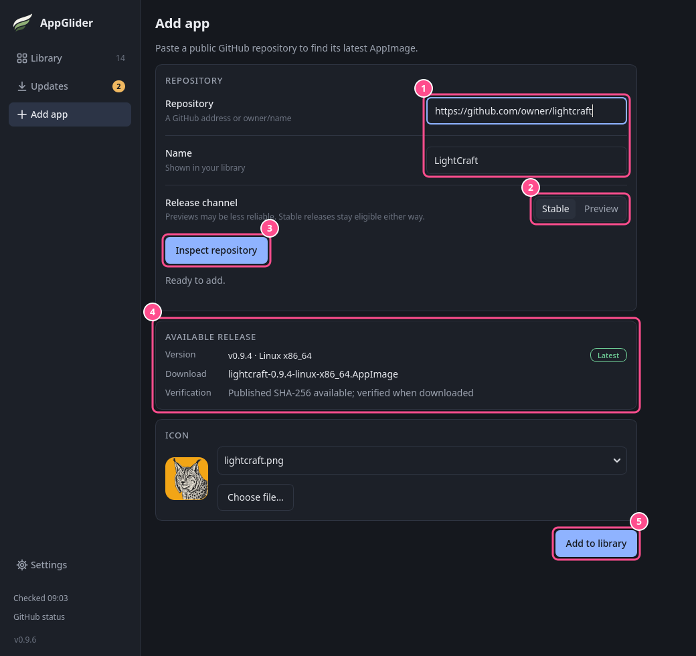

# Adding and installing apps

AppGlider installs apps from public GitHub repositories, and can also add an AppImage you already have on your computer. This page covers adding, installing and launching.

## Add an app from GitHub

1. Choose **Add app** in the sidebar and paste the repository's address, such as `https://github.com/owner/project`. `github.com/owner/project`, `owner/project` or a link to one of its pages, such as its releases, work too. You can change the **Name** it gets in your library.
2. Leave **Release channel** on **Stable** unless you want to try test versions ([previews](updates-and-versions.md#stable-versions-and-previews)).
3. Choose **Look up app** (or press **Enter**). If you change **Release channel** afterwards, look the app up again.
4. AppGlider shows what it found: the version, the file it would download and whether the project published a checksum to check it with. Below that you can pick an icon, or use **Choose file…** to add your own to the list. If several downloads fit, a **Build variant** box asks which one you want.
5. Choose **Add and install** to put the app on your list and install it straight away, or **Add to library** to only put it on your list and open its page. **Add to library** does not download anything. You can also press **Enter** in the **Name** box.

The project needs a published release with an AppImage file and a published checksum. If something is missing, AppGlider tells you what. Leaving the page while it is still looking cancels the search.

To add many apps at once, use a [catalog](../catalogs.md).

> [!NOTE]
> AppGlider's own repository is refused: it already updates itself and keeps its own menu entry.

## An AppImage already on your computer

If you have an AppImage that did not come from GitHub, or from a project AppGlider cannot use, add it from a file. On the Add app page, at the bottom under **Add a file from this computer**:

1. Choose **Choose AppImage…** and pick the file. The picker opens in your Downloads folder.
2. AppGlider reads its name, version and icon from inside the file and shows them. You can change the **Name**. The repository form steps aside while a file is chosen; use **Choose another…** to pick a different file, or **Clear** to go back to the form.
3. Choose **Add to library**. The file is copied into AppGlider's install folder, with a progress bar beside the button, and **Cancel** stops it. The original stays where it is, and you can delete it afterwards.

The app gets a **◇ Manual** chip and works like any other installed app: **Launch**, a menu entry, launch options, **Pin to top**, **Force close** and **Uninstall**. The difference is that AppGlider cannot check it for updates, so it is left out of **Updates**, **Update all** and the update counts, and its page has no release notes or Versions.

To update it, download a newer file yourself, open the app's page and choose **Replace with a newer file…** under **Preferences**. The old file is kept, so **Roll back** still works. **Uninstall** removes the app from your list as well, since there is nothing to download again. The file you first added is never touched. A file identical to one you already have is refused.

## Installing and launching

Press **Install** on an app's row or its page. AppGlider:

1. downloads the version that matches your computer,
2. checks it against the checksum the project published, and that it really is an AppImage,
3. adds an entry to your application menu, named after the app (**PhotoCraft**). If another menu entry already uses that name, AppGlider's reads **PhotoCraft (AppGlider)**.

The row then shows **Launch**. A download that fails or that you cancel leaves nothing behind. Installed apps work offline. If an app fails to start, AppGlider tells you where to find its log file. When it quits with an error right after starting, the message also shows the end of that log.

If you want a program to run before or after each install, such as a virus scan, see [Install commands](install-commands.md).

AppGlider only manages the apps it installed itself. AppImages you downloaded some other way, or installed with another program, are left alone.

If an app does not start or cannot be added, see [Troubleshooting](../troubleshooting.md).
