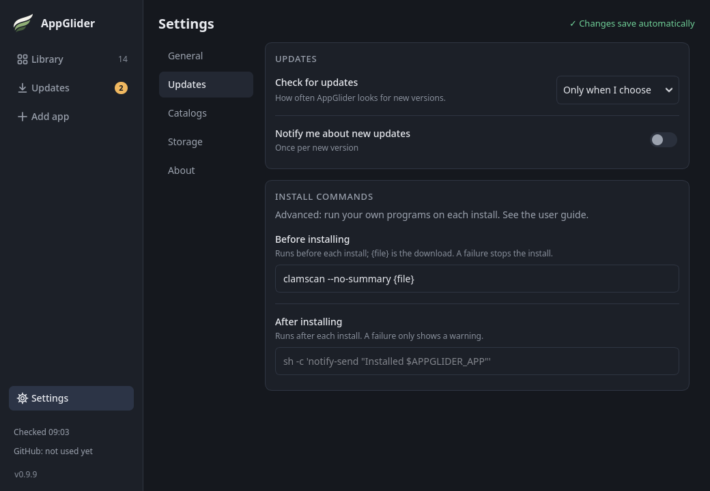

# Install commands

You can have AppGlider run a program of your own before and after it installs something. A common use is scanning each new AppImage with an antivirus before it is installed.

## Where to set them

Under **Settings → Updates** you can name a command to run **before installing** and one to run **after installing**. Both are off until you type something. They are the same for every app. Both boxes are in their own **Install commands** panel at the bottom of **Settings → Updates**.

They save when you press **Enter** or leave the box, and say **Saved** next to it for a moment. While an install or update is running you can still type, and the command is saved as soon as it ends.

## When they run

They run for an install, an update, **Update all**, adding an AppImage from a file and replacing the file of an app you added by hand. They do not run for **Roll back** or for AppGlider's own updates. **Cancel** stops a command that is running.

- **Before installing** runs on the new file once it has been downloaded and checked (its size and checksum), before it is made executable or put in place. If the command fails (exits with an error, takes longer than 10 minutes or cannot start), the install stops and your current version is kept. For an app added from a file, nothing is added.
- **After installing** runs once the new version is in place. If it fails or takes longer than 2 minutes, you only get a warning; the app stays installed.

## Writing a command

Write the command as you would in a terminal. `{file}` is replaced with the path of the AppImage; without `{file}`, the path is added at the end. There is no shell, so pipes, `&&` and `$VARIABLES` in the command itself do nothing: use `sh -c '…'` for those. The command also gets these environment variables, which a script can read:

| Variable | Value |
| --- | --- |
| `APPGLIDER_STAGE` | `before` or `after` |
| `APPGLIDER_FILE` | the path of the AppImage |
| `APPGLIDER_APP` | the app's name |
| `APPGLIDER_APP_ID` | the app's identifier |
| `APPGLIDER_VERSION` | the version being installed |
| `APPGLIDER_OLD_VERSION` | the version it replaces (empty for a new app) |

## Examples

- Scan with ClamAV before installing: `clamscan --no-summary {file}`. `clamscan` exits with an error when it finds something, so the install stops.
- Show a notification afterwards: `sh -c 'notify-send "Installed $APPGLIDER_APP $APPGLIDER_VERSION"'`. Or keep a log: `sh -c 'echo "$APPGLIDER_APP $APPGLIDER_VERSION" >> ~/appglider.log'`.

## If a command cannot be saved

If you type something AppGlider cannot read (for example an unclosed quote) or a program it cannot find, it says "Not saved" and why, and keeps the previous command.

> [!WARNING]
> The commands run as you, with your permissions. AppGlider only ever runs commands you entered yourself here. They are not included when you export a catalog. For how they are run, see [Security](../how-it-works/security.md#install-commands).
