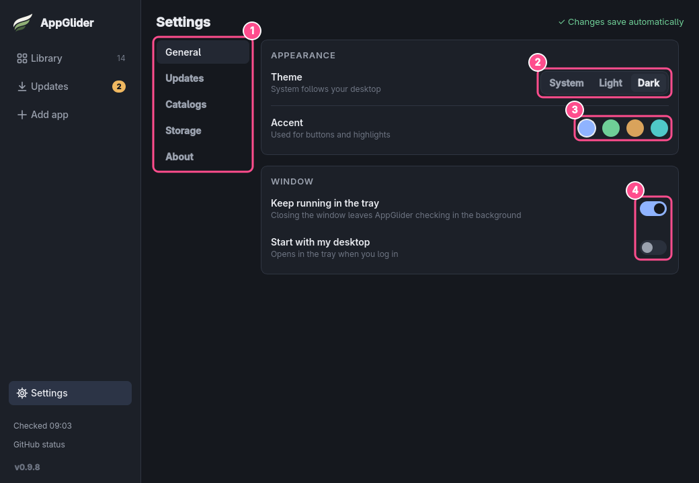
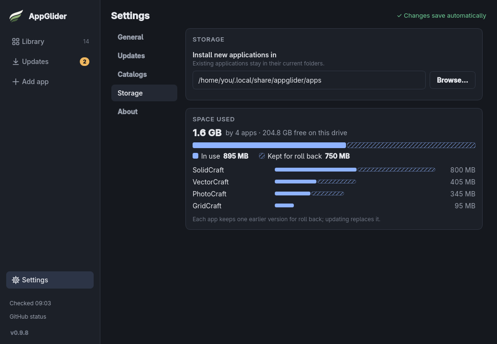

# Settings

Open **Settings** at the bottom of the sidebar. Everything saves as you change it; there is no Save button.

## The sections

1. **Sections**:
   - **General**: theme, accent colour and how the window behaves.
   - **Updates**: how often to check for updates, notifications, and an **Install commands** panel for programs to run before and after installing (see [Install commands](install-commands.md)).
   - **Catalogs**: import a list of apps from a file or a GitHub link, add the example list, or export your own (see [Catalogs](../catalogs.md)).
   - **Storage**: the folder new apps are installed in, moving AppGlider there, and the space they use.
   - **About**: the version, **Check now** for a new AppGlider, **What's new in …** for the notes of the version you are running, the licence (GPL-3.0-or-later, no warranty), and links to the website, the source code and the issue tracker.
2. **Theme**: **System** follows your desktop's light or dark setting; or choose **Light** or **Dark**. The window changes as you pick, so you can try them out. (The older Forest, Earthy and Sandstone themes now show as Dark with a matching accent.)
3. **Accent**: the colour of buttons and highlights: blue, green, amber or teal.
4. **Keep running in the tray** and **Start with my desktop**: see [The tray icon](desktop.md#the-tray-icon) and [Starting with your desktop](desktop.md#starting-with-your-desktop). Without a system tray, **Keep running in the tray** is switched off and says so.

## Storage

AppGlider installs apps in `~/.local/share/appglider/apps` unless you choose another folder. The folder must already exist: type its path and press **Enter**, or use **Browse…**, and "Applies to apps you install next." confirms it. Changing it only affects apps you install afterwards; apps you already have stay where they are and keep updating there.

> [!WARNING]
> If you use AppImageLauncher, do not choose its folder (usually `~/Applications`): it would treat AppGlider's apps as its own. AppGlider warns you if you do.

The **Space used** panel shows how much your apps take and how much space is free. One bar splits the total into **In use** (solid, the versions you run) and **Kept for roll back** (striped, the earlier copies), and each app is listed below, largest first. There is nothing to clean up by hand: AppGlider keeps only one earlier copy of each app, and each update replaces it. The sizes count the app files only, not the documents or settings the apps keep.

## Move AppGlider here

When AppGlider runs from some other folder, such as Downloads, this row appears. **Move here** copies AppGlider into the install folder, points its menu and login entries at the copy and restarts from it. The old file is removed once it is no longer running.

## Where settings are kept

The settings file and the other files AppGlider keeps are listed in [Files and folders](../how-it-works/files-and-folders.md).
