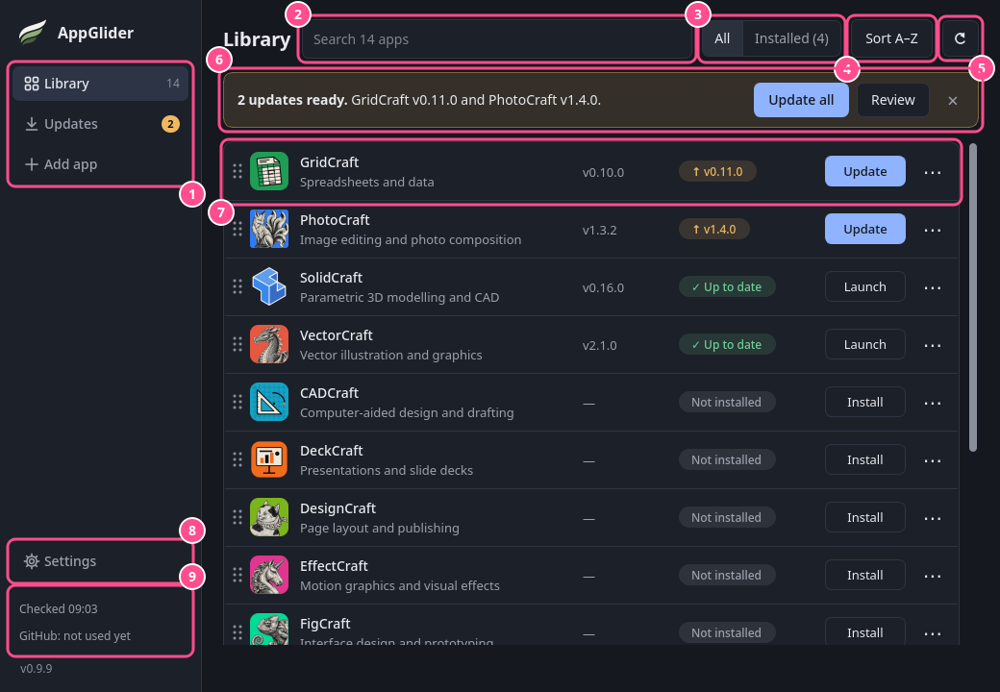
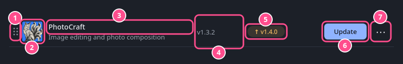
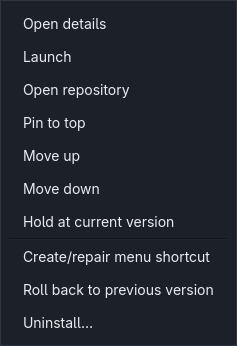
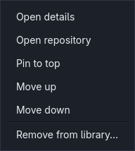
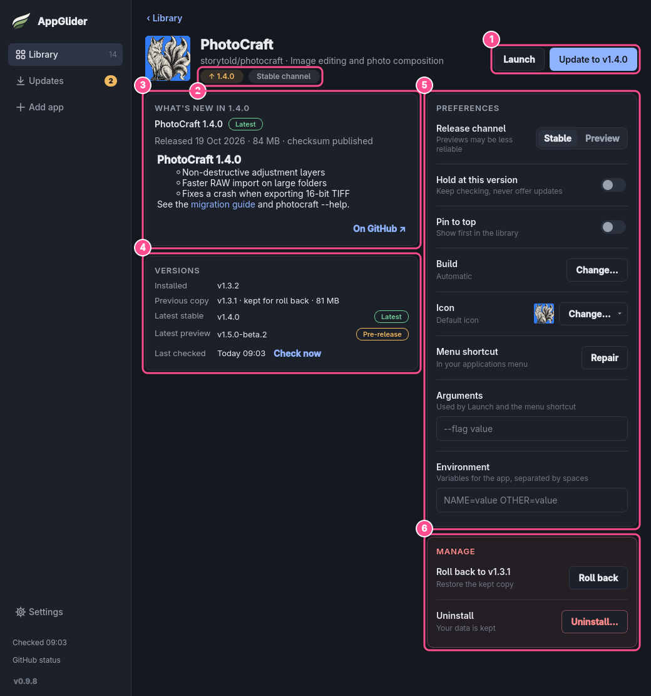

# A tour of the window

This page explains the parts of AppGlider's window: the Library, the rows, each app's page, your own order and the keyboard shortcuts.

## The Library

1. **Library, Updates and Add app.** **Library** lists every app (the number is how many you have). **Updates** lists only the apps with an update waiting; the amber badge says how many. **Add app** opens the page for [adding an app](adding-apps.md).
2. **Search** matches app names, descriptions and repository names. **Ctrl+F** jumps here from any page.
3. **All / Installed** shows every app, or only the ones you have installed.
4. **Sort A–Z** puts the list in A–Z order, after asking. It is hidden on the Updates page.
5. **Check for updates** (also **F5** or **Ctrl+R**) looks for new versions of your installed apps and of AppGlider itself. With no apps installed it checks only AppGlider.
6. **The updates banner** appears when updates are waiting. **Update all** installs them all; **Review** opens the Updates page; **×** closes it until another update comes out. If the only updates waiting need you to pick a build, it says so and offers **Choose build** instead.
7. **A row** for each app. Click anywhere on it (except its buttons) to open the [app's page](#the-apps-page).
8. **Settings** opens AppGlider's own [settings](settings.md).
9. **The status block** shows when updates were last checked, when the next check is due and how much of GitHub's allowance is left. Hover over it for details, or click it to choose how often to check. The version number below it opens **Settings → About**.

The bottom of the window stays empty until there is something to say: the result of something you did ("Updated 2 apps."), or a progress bar with **Cancel** while something downloads. Results fade away after a while.

## Rows

1. **Drag handle.** Drag the row up or down to put your apps in your own order.
2. **Icon.**
3. **Name and description.** A gold ★ beside the name means the app is pinned to the top.
4. **Installed version**, or **—** when it is not installed.
5. **Status chip**: what is going on with the app (see the table below).
6. **Main button**: the thing you most likely want to do next.
7. **⋯ menu**: more actions for this app.

| Chip | Main button | What it means |
| --- | --- | --- |
| ✓ Up to date | Launch | You have the newest version on offer |
| ↑ v1.4.0 | Update | A newer version is waiting |
| Choose build | Choose build | Several downloads fit; see [Choosing a build](updates-and-versions.md#choosing-a-build) |
| ‖ Held, or ‖ Held · v2.3.0 out | Launch | The app is [held](updates-and-versions.md#holding-a-version) at its version |
| Preview channel | Launch | The installed copy is a preview version |
| ▶ Running | Launch | The app is open now, and nothing more important needs saying (an available update, a failed check or a missing file still show instead) |
| Waiting for stable | Launch | You have a preview and are waiting for a newer stable release |
| Only previews | Launch | The project has published only preview versions; turn on previews to use them |
| Not checked | Launch | AppGlider has not looked for releases for this app yet |
| Checking… | Launch | AppGlider is looking for releases right now |
| Check failed | Launch | The last check failed; what was known before is kept |
| ⚠ File missing | Reinstall | The app's file was moved or deleted; see [When an app's file goes missing](../troubleshooting.md#an-app-shows--file-missing) |
| Not installed | Install | On your list but not downloaded yet |
| Installing… / Updating… (with a percentage while a download runs) | Cancel | Work is in progress |
| Waiting | Update (greyed out) | **Update all** will get to this app next |

Every chip has a word or symbol as well as a colour, and hovering over it explains it.

Without an internet connection, rows keep showing what AppGlider knew from its last check, and the GitHub status at the bottom of the sidebar says **GitHub: offline**. Your apps still launch as usual.

## The ⋯ menu

The menu only offers what makes sense for the app right now:

| An installed app | An app that is not installed |
| --- | --- |
|  |  |

**Force close…** appears while the app is running (see [Force close](updates-and-versions.md#force-close)). **Roll back to previous version** appears when AppGlider kept an earlier copy, and **Move up** and **Move down** appear while the list can be reordered. An app whose file went missing offers **Forget missing copy…** (**Forget…** for an app added from a file), and an app that is neither installed nor missing offers **Remove from library…**. Each state has only one of the three. While AppGlider is busy installing or updating something, the menu's actions and the row's button are greyed out, and hovering over them says to wait for the current task to finish or cancel it.

## Your own order and pinning

There is one order, and it is yours. At first the apps are sorted A–Z, and an app you add later goes to the end.

- **Drag a row** by its handle to move it; a line shows where it will land. **⋯ → Move up** and **Move down** do the same from the keyboard.
- **⋯ → Pin to top** keeps an app above all the others; **Unpin** puts it back.
- **Sort A–Z** in the toolbar puts everything back in A–Z order, after asking. Pinned apps stay on top.

Reordering works on the Library page with an empty search box, not on the Updates page. While it is off, the handles are dimmed and say why when you hover over them. With **Installed** selected, an app moves among the rows you can see and the hidden ones keep their places. The tray menu lists your installed apps in the same order.

## The app's page

Click an app's row to open its page. **‹ Library** (or **Esc**) takes you back to the list as you left it.

1. **Launch**, and the main action: Install, Update, Choose build, Reinstall or Cancel. While the app is open, Launch says "Already running".
2. **Status chips**: the app's state (the repository name above them opens the project on GitHub), and **Previews on** when the app follows the preview channel.
3. **What's new**: the release notes of the version on offer, with its date and size. Long notes start with the first few lines; **Show all notes** opens the rest right there, and **On GitHub ↗** opens the release page.
4. **Versions**: the installed version, the earlier copy kept for rolling back, the newest stable and preview versions, and when they were last checked. See [Versions on an app's page](updates-and-versions.md#versions-on-an-apps-page).
5. **Preferences** for this app. Changes apply straight away.
   - **Release channel**: see [Stable versions and previews](updates-and-versions.md#stable-versions-and-previews).
   - **Hold at this version**: see [Holding a version](updates-and-versions.md#holding-a-version).
   - **Pin to top**: keep the app at the top of the list.
   - **Build**: see [Choosing a build](updates-and-versions.md#choosing-a-build).
   - **Icon**: see [Icons](desktop.md#icons).
   - **Menu shortcut → Create or repair**: write the app's menu entry again.
   - **Arguments** and **Environment**: see [Launch options](launch-options.md).

   **Hold at this version** and **Menu shortcut** appear once the app is installed.
6. **Manage** (in red): **Force close** while the app is running, and **Uninstall…**, **Forget…** or **Remove from library…** depending on the app's state. An app added from a file also has **Roll back** here, as it has no Versions list. Each asks first. See [Uninstalling, forgetting and removing](updates-and-versions.md#uninstalling-forgetting-and-removing).

## Keyboard

Everything works from the keyboard. **Tab** moves between controls, and the one you are on has an outline in your accent colour.

| Key | What it does |
| --- | --- |
| **Tab** / **Shift+Tab** | Move to the next or previous control |
| **Enter** or **Space** | Press the focused button; on an app's name, open its page |
| **Ctrl+F** | Jump to the search box from any page |
| **F5** or **Ctrl+R** | Check for updates |
| **Esc** | Clear the search box when it has text; otherwise go back from an app's page, the Add app page or Settings. Going back from an app's page puts you on that app's row again |
